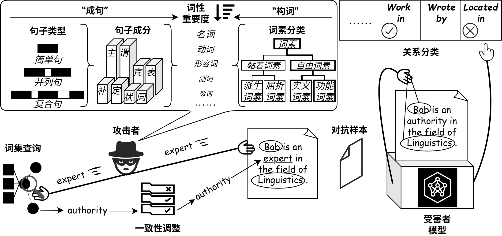

### :zap:Overview

  

### :flying_saucer:Instructions

> [!NOTE]
[DiagnoseAdv](https://github.com/zxlzr/DiagnoseAdv) is the backbone of this project, and we adhere to the instructions within it.

[Here](./our_method.py) is the entrance of our method.

### :new:Different from [/tree/main](https://github.com/JiangTianJason/Substitution_based_Attack)
1. Add experiments to test the transferability of TAEs on external LLMs (DeepSeek-v3 & r1), and [`./external_transferability`](./external_transferability) is the directory refers to the experiment in Table 3.12-3.14 in the thesis.
2. Statistic the [consistency of human judgments](./judgment_consistency.py) in Table 3.9 in the thesis.
